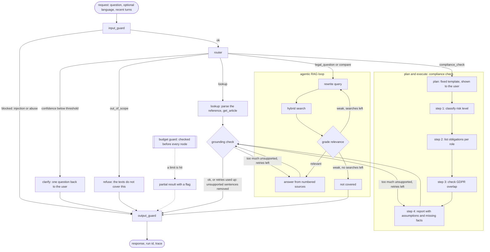

# Agent design (Stage 4A)

Design only: nothing here is implemented yet. It extends `docs/design.md` (which patterns we use and why) into a buildable spec for Stage 4B, and reuses what Stages 1 to 3 already built. Schemas below are specifications written in Python syntax, not code to copy.

## 0. Decisions

Decided by the owner (2026-10-29):

| Topic | Decision | Consequence |
|---|---|---|
| Orchestration | **LangGraph for the graph only** | `StateGraph`, conditional edges, typed state, an in-memory checkpointer per run and node-level streaming come from `langgraph`. Every model call still goes through our provider layer (`FallbackLLM`: fallback, retries, usage records); no LangChain model wrappers. New dependencies: `langgraph` (and its `langchain-core` dependency). |
| `classify_ai_risk` | **The model extracts facts, rules decide** | A small model fills a fixed fact checklist; deterministic rules map the facts to a category with article citations. Unknown facts become questions instead of guesses. |
| State | **Stateless API for now** | The client sends the recent turns with each request. A run's state lives in memory for that run only and comes back as a run id plus a trace. No database. |
| Compliance stance | **Indicative, with gaps** | The report states the likely category for the system as described, cites the articles, lists obligations per role, and lists every assumption and missing fact that could change the result, under an "information, not legal advice" notice. |

Defaults I chose that the owner can still override are listed in section 9.

### What already exists and is reused

| Piece | Where | Used by |
|---|---|---|
| Hybrid retrieval (BM25 + vectors, RRF), BM25 fallback, metadata filters | `answer/retrieval.py`, `retrieve/` | `search_regulation`, the RAG loop |
| Corpus units, cite ids and labels (`aiact:art:6:2` ↔ `AI Act Art. 6(2)`) | `ingest/`, `answer/labels.py` | all tools |
| Citation parsing and validation against supplied sources | `answer/citations.py`, `answer/grounding.py` | output guardrail |
| Grounding check (second cheap model call per sentence) | `answer/grounding.py` | the critic node |
| Refusal gate (no sources; English cosine threshold, provisional) | `answer/refusal.py` | the grade node |
| Provider layer with fallback, streaming, timeouts, usage | `llm/` | every model call |
| Cross-references extracted per unit (`refs`) | corpus field | `cross_reference` |

## 1. The graph



Node by node:

| Node | Model call | What it does |
|---|---|---|
| `input_guard` | none (rules); optional small model for ambiguous injection cases | Length and language checks, injection and abuse patterns, personal-data redaction for logs (section 5). Blocks only what must never run; everything else continues, flagged. |
| `router` | 1 small-tier call, JSON output | Returns `route`, `confidence`, `language`, `regulation_hint` and, for a compliance request, whether a system description is present. A deterministic pre-check runs first: an explicit reference ("Art. 22 GDPR", "Annex III") routes to `lookup` without a model call. |
| `clarify` | 1 small-tier call (or a template) | Writes ONE clarifying question in the user's language and ends the run. At most one clarification per question: if the client resends with the answer, the router must route (section 9). |
| `lookup` | 0 to 1 | Parses the reference with the citation parser, calls `get_article`, and answers with the text plus a short summary (summary sentences are grounding-checked). |
| `rewrite` | 1 small-tier call | Turns the question (and, on a re-search, the grader's reason) into 1 to 3 search queries in the corpus language: legal vocabulary ("prohibited" for "banned", "Geldbußen" for "Bußgelder"), which the Stage 2 BM25 misses showed is the main weakness. For `compare` it writes one query per regulation. |
| `hybrid search` | 0 (1 query embedding per query) | `search_regulation` per query, merged by chunk id. |
| `grade` | 1 small-tier call | Labels each retrieved chunk relevant or not for the question, and decides: answer, re-search (with a reason, at most 2 times), or not covered. Applies `should_refuse` first (no sources, or cosine below the language's threshold). |
| `answer` | 1 large-tier call | The Stage 3 prompt: numbered sources with labels, answer in the question's language, `NOT_COVERED` allowed. On a regeneration it also receives the list of sentences the critic rejected. |
| `plan` | 0 | The compliance plan is a fixed template (structure is known in advance, per `design.md`), filled with the system description and shown to the user before execution. |
| steps 1 to 3 | per step: a short ReAct loop, at most 3 tool calls | Each step may only use its allowed tools (section 5) and must return a typed step result. |
| `report` | 1 large-tier call | Writes the indicative report from the step results only (they are its sources). |
| `grounding check` | 1 small-tier call | The Stage 3 critic. Unsupported sentences are removed. If more than half of the sentences were removed, or any cited source was not supplied, the draft is regenerated with feedback, at most 2 times; after that the filtered draft is returned with `grounded = false`. |
| `output_guard` | none | Final validation and response assembly (section 5). |
| `budget guard` | none | Not a node on the diagram path: a check that runs before every node and diverts to the partial result when a limit is hit (section 4). |

## 2. State

Pydantic models (the project already uses Pydantic, and LangGraph accepts them as graph state). Three parts with different lifetimes: what the user and client own (conversation), what one run owns (task), and what the run has spent (budget).

```python
# Specification, not implementation.

Route = Literal["lookup", "legal_question", "compliance_check", "compare", "out_of_scope"]


class Turn(BaseModel):  # conversation state: sent by the client each time
    role: Literal["user", "assistant"]
    text: str  # assistant turns: the final answer only, no traces


class ConversationState(BaseModel):
    turns: list[Turn]  # last few turns, capped (e.g. 6) by the API
    language: Language | None  # forced by the client, else detected


class SourceRef(BaseModel):  # anything a sentence may cite
    cite_id: str  # "aiact:art:6:2"
    label: str  # "AI Act Art. 6(2)"
    unit_id: str
    text: str  # bounded (6000 chars, as in Stage 3)


class SearchAttempt(BaseModel):
    queries: list[str]
    chunk_ids: list[str]
    relevant_ids: list[str]
    reason: str | None  # the grader's reason when it asked for a re-search


class RiskFacts(BaseModel):  # filled by the small model inside classify_ai_risk
    ...  # see section 3, classify_ai_risk


class StepResult(BaseModel):  # one compliance plan step
    step: Literal["classify", "obligations", "gdpr_overlap"]
    status: Literal["done", "partial", "skipped", "failed"]
    summary: str  # bounded, for the report prompt
    sources: list[SourceRef]
    assumptions: list[str]
    missing_facts: list[str]  # turned into questions in the report


class TaskState(BaseModel):  # owned by one run, discarded after it
    run_id: str
    question: str
    route: Route | None
    route_confidence: float | None
    regulation_hint: Literal["aiact", "gdpr", "both"] | None
    searches: list[SearchAttempt]  # at most 3: the first search and 2 re-searches
    sources: list[SourceRef]  # everything the answer may cite, deduplicated
    plan: list[str] | None  # compliance route only, shown to the user
    steps: list[StepResult]
    draft: str | None
    critic_rounds: int  # regenerations so far, at most 2
    removed_sentences: list[str]
    tool_calls: list[ToolCall]  # name, normalized args, args hash, ok, latency


class Limits(BaseModel):  # per route, see section 4
    max_steps: int
    max_model_calls: int
    max_tool_calls: int
    max_tokens: int  # input + output, all model calls of the run
    timeout_s: float
    max_cost_usd: float | None  # None while we only use free tiers


class BudgetUsed(BaseModel):
    steps: int
    model_calls: int
    tool_calls: int
    input_tokens: int
    output_tokens: int
    unreported_token_calls: int  # calls whose provider gave no token counts
    elapsed_s: float
    cost_usd: float | None  # only with a sourced price file (CLAUDE.md rule)
    models: list[str]  # "provider:model" per call


class AgentState(BaseModel):  # the LangGraph state
    conversation: ConversationState
    task: TaskState
    limits: Limits
    used: BudgetUsed
    status: Literal["running", "done", "clarify", "refused", "partial", "blocked"]
    limit_hit: (
        Literal["steps", "model_calls", "tool_calls", "tokens", "timeout", "cost", "repeated_call"]
        | None
    )
    trace: list[TraceEvent]  # node, start/end, tokens, tool, outcome
```

Rules for the state:
- Nodes return partial updates; lists that grow (`searches`, `steps`, `tool_calls`, `trace`) are append-only.
- Only `output_guard` writes the response. The response contains the answer, citations, `grounded`, `status`, `limit_hit`, `route`, the plan (compliance), `missing_facts`, `usage` and `run_id`. The trace is returned only when the client asks for it (it can be large).
- Sources are the only thing an answer may cite. Every tool that returns legal text adds `SourceRef`s, so the citation validator from Stage 3 works unchanged.

## 3. Tools

All tools are read-only, take Pydantic-validated arguments, return bounded output, and on failure return a structured error whose message tells the model how to recover (never a stack trace). Tool output is wrapped as data: the model is told it is quoted text, not instructions.

Common error shape:

```python
class ToolError(BaseModel):
    error: Literal[
        "invalid_argument",
        "not_found",
        "no_results",
        "too_long",
        "insufficient_facts",
        "budget",
        "repeated_call",
    ]
    message: str  # written for the model: what went wrong and what to do instead
```

### `search_regulation`

Description given to the model:
> Search the official text of the AI Act and the GDPR for passages relevant to a question. Use it when you need the provisions that answer a substantive question and you do not know the exact article. Write queries with the legal vocabulary of the regulation ("prohibited practices", not "banned AI"), in the language you were told to use. Do not use it to fetch an article whose number you already know (use get_article), nor to look up what a term means (use get_definitions). Results are passages, not answers: read them before relying on them.

| Field | Type | Rule |
|---|---|---|
| `query` | str | 3 to 300 characters |
| `regulation` | `"aiact"` \| `"gdpr"` \| `"both"` | default `"both"` |
| `language` | `"en"` \| `"fr"` \| `"de"` | required: the corpus to search |
| `k` | int | 1 to 8, default 6 |

Output: up to `k` items `{label, cite_id, title, snippet, score_rank}`, snippet at most 600 characters, plus `mode` (`hybrid` or `bm25`) and `notes`. Full text is not returned: the model calls `get_article` for a passage it needs in full.

Errors: `invalid_argument` ("language must be en, fr or de; use the language of the question"), `no_results` ("No passage matched. Rephrase with the regulation's own terms, try the other regulation, or check the term with get_definitions. If two rephrasings fail, the texts probably do not cover this.").

### `get_article`

> Fetch the full text of one provision when you know its reference, for example "Art. 6(2)", "Article 22" or "Annex III, point 4". Use it to read a passage that search returned only as a snippet, or when the user names a provision. Do not guess numbers: if you are not sure which article applies, search first.

| Field | Type | Rule |
|---|---|---|
| `regulation` | `"aiact"` \| `"gdpr"` | required |
| `reference` | str | "6", "6(2)", "5(1)(f)", "Annex III", "Annex III, point 4"; parsed with the Stage 3 citation parser |
| `language` | `"en"` \| `"fr"` \| `"de"` | required |

Output: `{label, cite_id, title, chapter, text, parts, truncated, refs}`: `text` at most 4000 characters (`truncated` says so; `parts` lists the paragraph and point labels so the model can fetch a smaller part), `refs` are the unit's cross-references.

Errors: `not_found` ("AI Act articles run from 1 to 113 and annexes I to XIII; GDPR articles from 1 to 99 and it has no annexes. Check the number, or search."), `invalid_argument` ("Write the reference like '6(2)' or 'Annex III, point 4'.").

### `get_definitions`

> Look up how the regulations define a term ("AI system", "provider", "personal data", "deep fake"). Use it before you rely on a defined term, or when the user asks what something means. Definitions come from AI Act Art. 3 and GDPR Art. 4 only; a term not defined there is not a legal definition, so do not use this tool for general vocabulary.

| Field | Type | Rule |
|---|---|---|
| `term` | str | 2 to 80 characters |
| `regulation` | `"aiact"` \| `"gdpr"` \| `"both"` | default `"both"` |
| `language` | `"en"` \| `"fr"` \| `"de"` | required |

Output: at most 3 `{label, term, text}` (text at most 1500 characters), best match first: exact term, then accent- and case-folded, then fuzzy on the term only.

Errors: `no_results` ("No defined term matches. Closest defined terms: ... . If none fits, the term is not defined in these regulations.").

### `classify_ai_risk`

> Classify an AI system described by the user into the AI Act's categories: prohibited practice, high-risk, limited risk (transparency duties) or minimal risk. Use it only in a compliance check, once you have the system's purpose, users and context. It returns the category, the provisions it rests on, the facts it used, and the facts still missing. Never state a category without it, and pass its missing facts on to the user instead of filling them in yourself.

| Field | Type | Rule |
|---|---|---|
| `system_description` | str | 30 to 3000 characters |
| `known_facts` | `RiskFacts` (partial) | optional: facts already confirmed by the user |
| `language` | `"en"` \| `"fr"` \| `"de"` | required |

How it works (the owner's decision: model extracts, rules decide):
1. A small-tier model fills the `RiskFacts` checklist from the description. Each fact is `yes`, `no` or `unknown`, with the phrase of the description that supports it; it may not infer beyond the description.
2. Deterministic rules decide, in this order, and record the provisions used:
   - any prohibited-practice fact `yes` (one flag per point of Art. 5(1), (a) to (h)) → **prohibited**;
   - safety component of a product under Annex I legislation → **high-risk** (Art. 6(1));
   - use case in an Annex III area (1 to 8) → **high-risk** (Art. 6(2) and the Annex III point), unless the Art. 6(3) derogation conditions are met and the system does not perform profiling of natural persons, which Art. 6(3) excludes from the derogation;
   - otherwise → **minimal**;
   - separately, Art. 50 triggers (interacts with people, generates synthetic content, emotion recognition or biometric categorisation, deep fakes) add **transparency obligations**, which can apply on top of high-risk;
   - a general-purpose AI model is a separate track (Art. 51 to 55), reported as such.
3. If a fact that decides the outcome is `unknown`, the category is **undetermined** for that branch and the fact goes to `missing_facts` as a question.

Output: `{category, transparency_obligations, gpai, basis: [labels], annex_iii_point, facts: RiskFacts, missing_facts: [questions], derogation_considered}`, about 1500 characters at most. The rule table is a versioned data file with one test case per row.

Errors: `insufficient_facts` ("The description does not say what the system is for or who uses it. Ask the user for its purpose, who it affects, and where it is used, then call again."), `too_long`.

> Legal content warning: the rule table is an interpretation of Art. 5, Art. 6, Art. 50 and Annex III. It must be reviewed against the text, ideally by the owner, before results are shown as anything more than indicative.

### `list_obligations`

> List the AI Act obligations that apply to one role for one risk category, as the provisions themselves (labels and short quotes), not as advice. Use it after classify_ai_risk, once per role the user plays (provider, deployer, importer, distributor, authorised representative). Do not use it to decide the category, and do not paraphrase the result beyond what the quotes say.

| Field | Type | Rule |
|---|---|---|
| `role` | `"provider"` \| `"deployer"` \| `"importer"` \| `"distributor"` \| `"authorised_representative"` | required |
| `category` | `"high_risk"` \| `"limited"` \| `"gpai"` \| `"gpai_systemic"` | required (prohibited systems have no obligations to list: they may not be placed on the market) |
| `language` | `"en"` \| `"fr"` \| `"de"` | required |

How it works: a small, reviewed table maps (role, category) to the articles that list that role's obligations (for example provider and high-risk → Art. 16 and the articles its points refer to; deployer and high-risk → Art. 26 and Art. 27; any role and limited → Art. 50; GPAI → Art. 53, plus Art. 55 for systemic risk). The tool returns those units' points with their labels and the start of their text, straight from the corpus: no generated summaries.

Output: at most 20 `{label, title, quote}` (quote at most 300 characters), plus `more` if the list was cut.

Errors: `invalid_argument` ("role must be one of provider, deployer, importer, distributor, authorised_representative; if the user's role is unclear, ask"), `not_found` ("No obligations table entry for this role and category. Prohibited practices have no obligations: they are banned.").

### `cross_reference`

> Find provisions connected to a given one: the articles it refers to, the articles that refer to it, and the related provisions of the other regulation (AI Act ↔ GDPR). Use it in comparisons and in the GDPR overlap step. Do not use it to search by topic.

| Field | Type | Rule |
|---|---|---|
| `regulation` | `"aiact"` \| `"gdpr"` | required |
| `reference` | str | as in `get_article` |
| `language` | `"en"` \| `"fr"` \| `"de"` | required |

How it works: `refers_to` comes from the unit's `refs` (Stage 1), `referred_by` from the reverse index over all units, `other_regulation` from a small curated table of AI Act ↔ GDPR pairs, each with a one-line reason (for example AI Act Art. 10 ↔ GDPR Art. 6 and 9 on data; AI Act Art. 26(9) ↔ GDPR Art. 35 on impact assessments; AI Act Art. 86 ↔ GDPR Art. 22 on automated decisions). The corpus `refs` cannot provide that last part: references to other acts were deliberately skipped in Stage 1.

Output: at most 10 per list, `{label, title}` only (the model fetches text with `get_article`).

Errors: `not_found` (as `get_article`).

## 4. Control: limits and what happens when one is hit

Measured so far (Stage 3, single-answer pipeline: two runs of the 10 README examples plus smoke tests): 1,170 to 4,349 input tokens and 4 to 1,498 output tokens per answer, 1 to 2 successful model calls, 1.7 to 87 s wall time (provider load dominated the slow cases). The agent adds a router, a rewrite and a grader call, and possibly re-searches. The limits below are proposals from those numbers, to be checked against traces in Stage 4B.

| Limit | lookup | legal_question / compare | compliance_check |
|---|---|---|---|
| graph steps | 6 | 14 | 30 |
| model calls | 3 | 9 | 16 |
| tool calls | 2 | 6 (at most 3 searches) | 15 (at most 3 per plan step) |
| tokens (input + output) | 12,000 | 40,000 | 120,000 |
| wall time | 30 s | 90 s | 180 s |
| cost | none while on free tiers; `max_cost_usd` applies once `evals/prices.json` holds sourced prices | same | same |

Token counts a provider does not report are counted as unknown, never as zero: if more than 2 calls in a run report no tokens, the budget guard estimates from characters (4 characters per token, stated as an estimate in the trace) so the ceiling still holds.

Repeated-call detection: every tool call is keyed by its name plus normalized arguments (lowercased, whitespace folded, defaults filled in).
- Second identical call in a run: not executed; the earlier result is returned with `repeated_call`: "You already called this with the same arguments; the result is above. Change the query or move on."
- Third identical call: the current step stops (`partial`), and for the RAG loop the search phase ends.
- No progress: a re-search whose results contain no chunk not seen before ends the loop as if no searches were left.

When a limit is hit, the run never crashes and never returns an unverified answer:
- `status = "partial"`, `limit_hit` names the limit, and the HTTP status is still 200.
- If a grounded draft exists, it is returned with what it covers. If a draft exists but has not been checked, it is checked within a reserved budget (the guard keeps 1 model call and 6,000 tokens back for the critic); if even that is impossible, the draft is withheld and a refusal is returned.
- Compliance runs return the completed steps, say which steps did not run, and list the missing facts so far.
- The answer text says plainly that it is partial, in the user's language.

## 5. Guardrails

### Input (`input_guard`, before the router)

| Check | How | On failure |
|---|---|---|
| Length, emptiness, language | 3 to 2000 characters (as the Stage 3 API); detected language must be en, fr or de, or forced | 422 from the API, or answer in English with a note |
| Prompt injection | Rules first: phrases such as "ignore previous instructions", "system prompt", role-play overrides, attempts to define new tools, long encoded blobs; then, only if a rule fires weakly, one small-tier classification call | Requests to reveal prompts, keys or configuration, or to change behaviour, are **blocked** with a fixed message. A legal question that merely contains injected text continues, with the suspicious span removed from what the router and rewriter see, and the event is traced. |
| Off-topic | The router's `out_of_scope` route plus the retrieval gates (cosine threshold, `NOT_COVERED`) | Refusal in the user's language |
| Legal-advice bait ("am I compliant?", "can I sign this?") | Router signal | Not refused: answered as information about the texts, with the notice, and for compliance questions routed to the indicative check |
| Personal data in the question (e-mail addresses, phone numbers, ID-like numbers) | Regex | Redacted in logs and traces only; the question itself is kept so the user's own text still works |

Tool results and retrieved passages are always data: they are delimited and introduced as quotations in every prompt, and the static system prefix says so. The lethal-trifecta check from `design.md` still holds: the agent reads only public law texts and has no tool that sends anything out, so there is no exfiltration path even if an injection succeeds.

### Output (`grounding check` and `output_guard`)

| Check | Rule |
|---|---|
| Citations present | Every sentence that states a rule or fact carries a citation; uncited claims are removed (the Stage 3 checker already treats them as unsupported) |
| Citations valid | Each citation parses and points to a source supplied in this run (tool or retrieval result); otherwise the sentence is removed without a model call |
| Grounded | The critic judges each sentence against its cited sources; `grounded = true` only if nothing was removed |
| Language and format | Answer language matches the question's; no HTML or links; length bounded (about 600 words; compliance report about 900) |
| Compliance report | Must contain the category (or "undetermined"), the basis, obligations per role, assumptions, missing facts and the notice; a missing section triggers one regeneration |

### Action (tools)

| Check | Rule |
|---|---|
| Allow-list per node | router, clarify, answer, report: no tools. RAG loop: `search_regulation`, `get_article`, `get_definitions`, `cross_reference` (compare only). Step 1: `classify_ai_risk`, `get_article`, `get_definitions`. Step 2: `list_obligations`, `get_article`. Step 3: `cross_reference`, `search_regulation` (`regulation = "gdpr"`), `get_article`. A call outside the list is rejected with an error naming the allowed tools. |
| Argument validation | Pydantic schemas above; errors use the recovery messages, so the model can fix the call; invalid arguments still count toward the tool-call limit |
| No side effects | All tools are read-only over the local corpus and cache; no network calls except the model and embedding providers through our layer |

## 6. Patterns we skip on purpose

| Pattern | Why not here |
|---|---|
| Multi-agent supervisor or swarm | One domain and six tools. A second agent would add hand-offs, cost and failure modes without adding capability; a router plus fixed sub-flows covers the task types. |
| Hierarchical agents | Same reason: the compliance check has a known four-step structure, so a fixed plan is enough. |
| Tree search, LATS, best-of-n sampling | Several times the calls for questions whose answer is in a known corpus; the cost ceiling would be blown for a small gain. |
| Debate between models | Faithfulness is checked against the source text by the critic, which is cheaper and more objective than two models arguing. |
| Open-ended reflection loops | The critic has a hard cap (2 regenerations) and a concrete criterion (support in cited sources), not "improve your answer". |
| Free-form ReAct for the whole run | Only inside plan steps, with an allow-list and at most 3 calls. A free agent loop over the whole task is harder to test, and the routes are known in advance. |
| Human-in-the-loop approval | Every tool is read-only, so there is no irreversible action to approve. The human role is the clarifying question and the missing facts. |
| Long-term or vector memory of conversations | The API is stateless by decision; recent turns come from the client. |
| Web search or browsing | The corpus is fixed and authoritative; web results would weaken grounding and open an exfiltration and injection path. |
| Code execution or dynamic tools | Nothing to compute; it would only add attack surface. |
| Fine-tuning | No labelled data at that scale, and retrieval plus prompts are cheaper to change. |

## 7. Tracing and evaluation hooks

Each node appends a `TraceEvent` (node, start and end, model and tokens, tool and arguments hash, outcome). That gives the trajectory rules in `design.md` something to check in Stage 4B:
- a substantive answer was preceded by at least one search or `get_article` call;
- at most 3 searches; no repeated call executed twice;
- a compliance run visited classify, obligations and GDPR overlap, or says which it skipped and why;
- every citation in the answer comes from a tool result of the same run.

Route labels are needed to evaluate the router: the 52 questions we have (40 gold plus 12 out-of-scope) carry scopes, not routes. Labelling them is an owner task in Stage 4B.

## 8. Build order for Stage 4B (no code yet)

1. Tools as plain functions with schemas, errors and bounds, with unit tests (`design.md` "Unit" level). The `classify_ai_risk` rule table and its cases come first, because they are legal content to review.
2. State models and the budget guard, tested with fake nodes (limits, repeated calls, partial results).
3. The graph with fake models: every route, the re-search cap, the critic cap, clarify, partial.
4. Real models behind the existing provider layer; trajectory rules over traces.
5. API: the existing `/ask` gains `route`, `status`, `plan`, `missing_facts`; streaming emits node events.

## 9. Defaults I chose (the owner may change them)

| Default | Value | Why |
|---|---|---|
| Router confidence threshold for a clarifying question | 0.6, then calibrated on route-labelled questions | Model-reported confidence is poorly calibrated; until labels exist this is a placeholder, and the router also uses deterministic signals |
| Clarifications per question | 1 | Avoids a loop of questions; after one, the agent answers with stated assumptions |
| Re-searches | 2 (3 searches in total) | The brief's limit |
| Critic regenerations | 2, triggered when more than half of the sentences are removed | `design.md` says max 2 retries; below that threshold the filtered answer is more useful than a rewrite |
| Router, rewrite, grade, critic tier | small (`gemini-3.1-flash-lite`, then Groq) | Cheap classification work |
| Answer and report tier | the current generation chain | As in Stage 3 |
| Plan display | The plan is streamed before execution, in the user's language | `design.md`: the plan is shown to the user |
| Obligations table and AI Act ↔ GDPR pairs | Drafted by me, reviewed by the owner | They are legal content |
